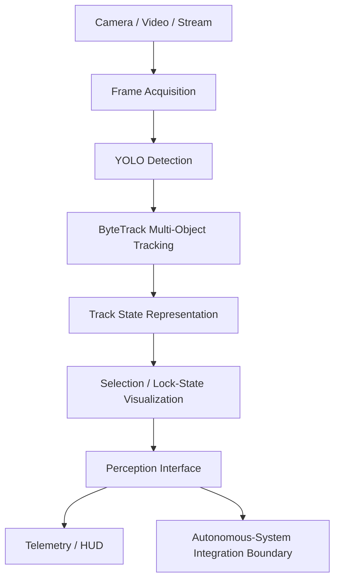

# Public-Safe System Architecture

This repository documents the **perception and software-integration** side of an automated interceptor-drone project. Operational control logic is intentionally excluded.

## Component responsibilities

### Frame acquisition
Accepts webcam, recorded video, or network-stream sources while keeping source handling separate from inference.

### Detector
Produces class, confidence, and bounding-box metadata.

### Tracker
Associates detections across frames and provides persistent track IDs.

### Track state
Normalizes visible track metadata so downstream software receives a stable representation.

### Perception interface
Defines the boundary between vision software and the rest of the autonomous stack. The public repository stops at this interface.

## Deliberately excluded

- proprietary company source code
- flight-controller commands
- navigation/control laws
- interception or engagement logic
- private datasets, footage, credentials, and model weights
